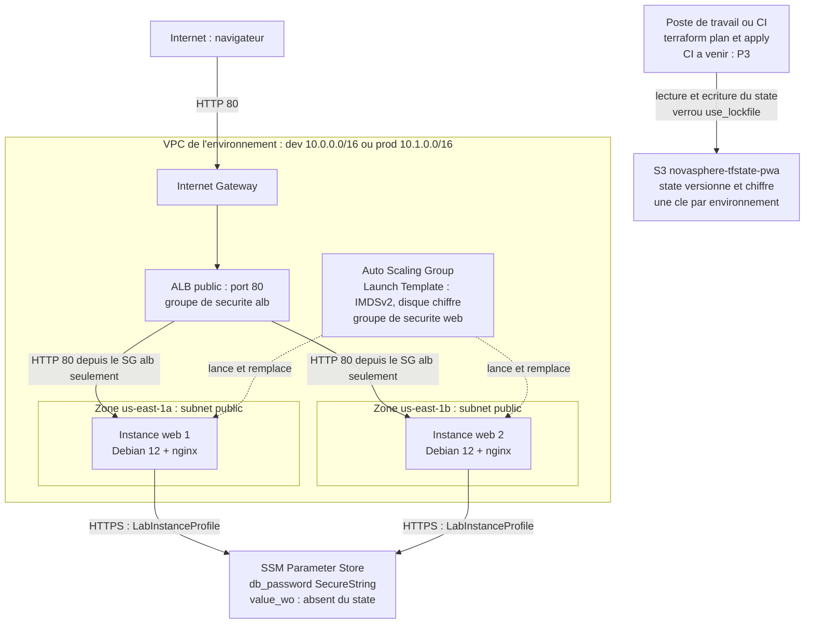

# Architecture NovaSphere

Projet fil rouge Terraform, Master SRC. Environnement : AWS Academy Learner Lab, région `us-east-1`.

Ce document décrit l'infrastructure déployée par ce dépôt : ce qu'on a construit, pourquoi, et ce qui reste à faire.
Il a été rédigé par **P1 (Pengchao, infrastructure et référent AWS)**. Les parties qui appartiennent aux autres membres sont marquées **P2** (sécurité) et **P3** (automatisation et Git). Tout ce qui n'est pas encore réalisé est indiqué **« à venir »**.

## 1. Vue d'ensemble

NovaSphere est un petit service web en haute disponibilité : un **Application Load Balancer (ALB)** reçoit le trafic HTTP et le répartit sur **au moins 2 serveurs** Debian 12 avec nginx, placés dans **2 zones de disponibilité**. La page d'accueil affiche le nom de l'environnement (`NovaSphere - dev` ou `NovaSphere - prod`) et le nom de la machine qui répond.

Le même code déploie deux environnements isolés, **dev** et **prod**, dans deux dossiers distincts (`envs/dev`, `envs/prod`), chacun avec son propre fichier d'état.

Deux dépôts Git :

| Dépôt | Rôle |
|---|---|
| [Terraform_projet_fil_rouge](https://github.com/Pengchao020401/Terraform_projet_fil_rouge) | Le projet : environnements, réseau, état, documentation |
| [terraform-aws-web](https://github.com/Pengchao020401/terraform-aws-web) | Le module d'équipe (ALB + ASG + Launch Template), appelé par le tag `v1.0.0` |

## 2. Schéma



## 3. Composants

| Composant | Ressource Terraform | Où | Rôle |
|---|---|---|---|
| Réseau | `module.vpc` (registre `terraform-aws-modules/vpc/aws`, `~> 6.7`) | `envs/*/network.tf` | VPC, 2 subnets publics (`/24`), Internet Gateway, **pas de NAT Gateway** |
| Load balancer | `aws_lb.this`, `aws_lb_listener.http`, `aws_lb_target_group.this` | module | Point d'entrée public, port 80, health check HTTP sur `/` (code 200) |
| Groupe de sécurité de l'ALB | `aws_security_group.alb` | module | Entrée : port 80 depuis Internet. Sortie : port 80 vers le groupe `web` uniquement |
| Groupe de sécurité des serveurs | `aws_security_group.web` | module | Entrée : port 80 **uniquement depuis le groupe `alb`**. Sortie : ports 80 et 443 (apt et API SSM). **Aucun SSH** |
| Modèle de serveur | `aws_launch_template.this` | module | Debian 12, IMDSv2 obligatoire, disque racine gp3 chiffré, `LabInstanceProfile`, script de démarrage |
| Groupe d'auto-scaling | `aws_autoscaling_group.this` | module | Au moins 2 serveurs sur 2 zones, `health_check_type = "ELB"`, remplacement progressif (instance refresh) |
| Image | `data.aws_ami.debian` | `envs/*/main.tf` | Image Debian 12 officielle la plus récente |
| Script de démarrage | `bootstrap.sh` | `envs/*/` | 9 lignes : installe nginx, écrit la page, lit le secret dans SSM |
| État partagé | bucket S3 `novasphere-tfstate-pwa` | `envs/*/backend.tf`, `bootstrap-state/` | Versionné, chiffré, accès public bloqué, verrou natif |
| Secret applicatif | `aws_ssm_parameter` (SecureString, `value_wo`) | `envs/*/secrets.tf` | Mot de passe `/novasphere/<env>/db_password`, lu par les serveurs au démarrage. Écrit, validé, **déploiement à tester**. Voir `SECURITE.md` |
| Chaîne de livraison | GitHub Actions | **à venir (P3)** | Plan en commentaire de PR, apply dev au merge, prod protégée, détection de dérive |

## 4. Réseau et flux

Le VPC couvre deux zones (`us-east-1a`, `us-east-1b`). Chaque zone a un subnet public. Les adresses sont calculées à partir du CIDR de l'environnement :

| Environnement | VPC | Subnet zone a | Subnet zone b |
|---|---|---|---|
| dev | `10.0.0.0/16` | `10.0.1.0/24` | `10.0.2.0/24` |
| prod | `10.1.0.0/16` | `10.1.1.0/24` | `10.1.2.0/24` |

Les deux CIDR sont différents pour pouvoir, plus tard, relier ou comparer les environnements sans conflit d'adresses.

Les flux autorisés, et seulement eux :

| De | Vers | Port | Règle |
|---|---|---|---|
| Internet | ALB | 80 | `alb_http` : `0.0.0.0/0` (c'est le rôle d'un ALB public) |
| ALB | Serveurs web | 80 | Entrée du groupe `web` avec **source = groupe `alb`**, pas une plage d'adresses |
| Serveurs web | Internet | 80 | Sortie : installation des paquets (`apt`) |
| Serveurs web | Internet | 443 | Sortie : `apt` et API SSM Parameter Store |
| Administrateur | Serveurs web | aucun | **Pas de port 22, pas de clé SSH** |

Un serveur a une adresse IP publique (nécessaire pour sortir par l'Internet Gateway sans NAT), mais aucune règle ne laisse entrer le trafic d'Internet : seul l'ALB peut joindre un serveur.

## 5. État Terraform (backend)

- **Où** : bucket S3 `novasphere-tfstate-pwa`, créé une seule fois à la main avec `bootstrap-state/create-state-bucket.sh` (Terraform ne peut pas créer le bucket qui contient son propre état).
- **Protection du bucket** : versioning activé (retour possible à un état précédent), chiffrement AES256, accès public entièrement bloqué, et une bucket policy qui refuse tout accès non chiffré (`aws:SecureTransport`).
- **Un état par environnement** : `novasphere/dev/terraform.tfstate` et `novasphere/prod/terraform.tfstate`. Une erreur dans dev ne peut donc pas modifier prod.
- **Verrou** : `use_lockfile = true` (verrou natif S3, un fichier `.tflock` à côté de l'état). Pas de table DynamoDB : cette méthode est dépréciée.
- **Partage avec l'équipe** : la bucket policy autorise le `LabRole` des coéquipiers. Elle sera appliquée quand P2 et P3 auront donné leur numéro de compte AWS : **à venir**. L'accès entre comptes n'a pas encore été testé.

## 6. Environnements : dev et prod

Les deux dossiers ont **exactement les mêmes fichiers**. Seules ces valeurs changent :

| Élément | dev | prod |
|---|---|---|
| Clé du backend | `novasphere/dev/terraform.tfstate` | `novasphere/prod/terraform.tfstate` |
| `environment` | `dev` | `prod` |
| CIDR du VPC | `10.0.0.0/16` | `10.1.0.0/16` |
| Type d'instance (exemple de `terraform.tfvars.example`) | `t3.micro` | `t3.small` |
| Instances min / voulu / max | 2 / 2 / 4 | 2 / 3 / 6 |

Les noms de ressources suivent le modèle `novasphere-<environnement>-<trigramme>`, par exemple `novasphere-dev-pwa`. Les étiquettes (`Project`, `Environment`, `Owner`, `ManagedBy`) sont posées par `default_tags` et, pour les serveurs lancés par l'ASG, par le module.

**Statut** : l'environnement **dev** a été déployé et testé dans le Learner Lab (la page répond et alterne entre 2 serveurs situés dans 2 zones). Le déploiement de **prod** et la vérification du plan vide sont **à venir**. Le module a été appelé en chemin local pour ce test, puis l'appel par tag `v1.0.0` a été validé avec `terraform init` et `terraform validate`.

## 7. Le module `terraform-aws-web`

Dépôt séparé, appelé par :

```hcl
source = "git::https://github.com/Pengchao020401/terraform-aws-web.git?ref=v1.0.1"
```

- **Entrées** : 15 variables typées. Obligatoires : `name`, `vpc_id`, `public_subnet_ids`, `ami_id`, `user_data`, `instance_profile_name`. Les autres ont une valeur par défaut raisonnable (`t3.micro`, 2 à 4 instances, disque de 8 Go, health check sur `/`).
- **Validations** : `name` (3 à 24 caractères, car AWS limite les noms d'ALB et de target group à 32 caractères), `vpc_id` et `ami_id` (format), `public_subnet_ids` (au moins 2 subnets), `min_size >= 2`, `max_size >= min_size`, `desired_capacity` entre `min_size` et `max_size`, `instance_type` et `health_check_path` (format), `user_data` (non vide, 16 000 caractères au plus), `root_volume_size` entre 8 et 100.
- **Sorties** : 8 valeurs, dont `alb_url` (l'adresse à ouvrir), `alb_dns_name`, `asg_name`, `target_group_arn` et les identifiants des deux groupes de sécurité.
- **Aucun bloc `provider`** : la région et les étiquettes sont configurées par l'environnement qui appelle le module. Le module déclare seulement les versions requises (Terraform `>= 1.9`, provider AWS `~> 6.28`).
- **Versionnement par tag** : une version = un tag Git. Un tag publié n'est jamais déplacé. Pour changer le module : modifier, tester en dev, poser `v1.1.0`, puis changer `?ref=` dans `envs/dev/web.tf`, et enfin dans `envs/prod/web.tf`.
- **Scan de sécurité** (checkov sur le module) : 39 contrôles réussis, 0 échec, 9 ignorés. Chaque exception est écrite dans `main.tf` avec sa raison. Le détail est dans `SECURITE.md`.

## 8. Choix de conception, raisons et compromis

| Choix | Pourquoi | Compromis |
|---|---|---|
| **Subnets publics, sans NAT Gateway** | Une NAT Gateway est facturée à l'heure et le budget du Learner Lab est limité. Imposé aussi par le cahier des charges | Les serveurs ont une IP publique. On compense avec les groupes de sécurité : rien n'entre, sauf l'ALB sur le port 80. En production réelle, on mettrait les serveurs en subnets privés avec une NAT |
| **ALB devant un ASG** | L'ALB répartit la charge et n'envoie le trafic qu'aux serveurs sains. L'ASG relance un serveur défaillant | Coût de l'ALB (facturé à l'heure) |
| **`health_check_type = "ELB"`** | L'ASG remplace un serveur dont le site ne répond plus, pas seulement un serveur éteint | Il faut un délai de grâce (180 s) pour laisser le temps d'installer nginx |
| **`min_size >= 2` sur 2 zones** | Une panne d'une zone ne coupe pas le site | Deux serveurs en permanence, même en dev |
| **Groupes de sécurité chaînés** | Le groupe `web` accepte le groupe `alb` comme source : même si les adresses changent, la règle reste juste | Aucun |
| **Pas de SSH, pas de clé** | Moins de surface d'attaque. Les serveurs sont jetables et se configurent par script, on ne les administre pas à la main | Pour diagnostiquer, il faut passer par les logs ou remplacer le serveur. L'administration par SSM Session Manager serait une extension possible |
| **IMDSv2 obligatoire** (`http_tokens = "required"`, `hop_limit = 1`) | Empêche le vol des identifiants du serveur par une requête détournée (SSRF) | Les anciens outils qui utilisent IMDSv1 ne fonctionnent plus (aucun ici) |
| **Disque racine chiffré** (gp3) | Protège les données au repos, sans coût visible | Aucun |
| **`LabInstanceProfile`** | Le Learner Lab interdit de créer un rôle IAM : on utilise celui qui existe. La politique idéale est décrite dans `SECURITE.md` | Ce profil est plus large que nécessaire (principe du moindre privilège non respecté) |
| **Dossiers `envs/dev` et `envs/prod`, pas de workspaces** | Imposé. C'est aussi plus sûr : on voit dans quel dossier on travaille, et chaque environnement a son état | Fichiers dupliqués : on maintient la ressemblance par discipline et par revue de PR. Le module commun limite la duplication |
| **Module dans son propre dépôt, appelé par tag** | Imposé. Le projet reste reproductible : dev et prod ne changent pas tant qu'on ne choisit pas une nouvelle version | Deux dépôts à gérer |
| **VPC du registre public** | Module très utilisé et maintenu, moins de code à écrire et à relire | Dépendance externe, version bornée (`~> 6.7`) |
| **Version du provider figée** (`~> 6.28` et fichier `.terraform.lock.hcl`) | Toute l'équipe utilise le même provider | Il faut mettre à jour le fichier de verrou exprès |
| **Script de démarrage court, sans secret** | Le script lit le secret dans SSM au démarrage : il ne contient aucune valeur sensible, donc rien n'apparaît dans Git, dans l'état ou dans les logs | Les serveurs ont besoin d'un accès Internet sortant (ports 80 et 443) |
| **Secret en `value_wo` + variable `ephemeral`** | Avec un `value` classique, le mot de passe serait écrit en clair dans le state. Ici il part vers AWS sans y être enregistré, et la variable n'est pas conservée dans le plan (voir `SECURITE.md`) | Terraform ne voit plus la valeur : un changement se déclenche en augmentant `db_password_version`. Le mot de passe doit être fourni à chaque `plan`/`apply` (`TF_VAR_db_password`) |
| **HTTP seulement (port 80)** | Demandé par le socle. Le HTTPS est une extension possible | Trafic non chiffré entre le navigateur et l'ALB |

### Alternatives écartées

- **Workspaces Terraform** : écartés (interdits par le cahier des charges, et une erreur de workspace est facile à faire).
- **NAT Gateway avec subnets privés** : plus sûr, mais trop coûteux dans le Learner Lab.
- **State local** : écarté (il plafonne la note Terraform, et il ne se partage pas).
- **Table DynamoDB pour le verrou** : écartée (déprécié, remplacé par `use_lockfile`).
- **Serveur unique sans ASG** : écarté (pas de haute disponibilité).
- **Accès SSH avec clé** : écarté (surface d'attaque, et pas nécessaire).

### Extension choisie

**Administration sans SSH, par SSM Session Manager** (voir `CADRAGE.md`).

- Le script de démarrage `bootstrap.sh` installe l'agent SSM (`amazon-ssm-agent`, absent de l'AMI Debian) et le démarre.
- L'instance s'enregistre auprès de Systems Manager grâce au `LabInstanceProfile`, en sortant en HTTPS (port 443) par l'Internet Gateway : pas de VPC endpoint ni de NAT, donc aucun coût en plus.
- On ouvre un shell sur un serveur avec `aws ssm start-session --target <instance-id>` ou depuis la console (EC2, Connect, Session Manager). Le port 22 reste fermé et il n'y a aucune clé SSH.
- Chaque session est tracée par AWS (qui, quand, sur quelle instance), ce que SSH ne fait pas.

## 9. Contraintes du Learner Lab

- **Identifiants de session** : ils changent à chaque session et expirent. Il faut les recoller (variables d'environnement `AWS_ACCESS_KEY_ID`, `AWS_SECRET_ACCESS_KEY`, `AWS_SESSION_TOKEN`) au début de chaque séance. Ils ne doivent jamais être écrits dans un fichier du dépôt.
- **Pas de création de rôle IAM** : on utilise `LabInstanceProfile`. Hors Learner Lab, on créerait un rôle dédié avec une politique réduite (par exemple `ssm:GetParameter` sur `/novasphere/<env>/*` uniquement).
- **Région** : `us-east-1`.
- **Coûts** : ALB, instances et disques sont facturés à l'heure. On fait **`terraform destroy` à la fin de chaque session**. Le bucket du state, lui, doit rester.
- **Le bucket du state vit dans le compte de P1.** Il peut disparaître si le lab est réinitialisé. Avant une fin de session importante : `terraform state pull > state.json`.
- **Authentification de la CI** : avec le Learner Lab, ce sont des identifiants de session stockés dans les secrets du dépôt (à rafraîchir avant la démonstration). Avec un compte AWS personnel, on utiliserait un rôle OIDC, sans clé stockée : c'est préférable, mais impossible à créer dans le lab.

## 10. Limites connues et améliorations

**Limites actuelles**
- Dev est testé, **prod ne l'est pas encore**. Le plan vide sur le dépôt gelé n'est pas encore vérifié.
- Le secret SSM est écrit (`secrets.tf`) mais **pas encore déployé ni testé** dans le Learner Lab. Les serveurs ne démarrent qu'après la création du paramètre (`depends_on`). Si le paramètre manquait, la lecture du script échouerait et `/etc/novasphere/app.conf` resterait vide : le site fonctionnerait quand même, car le script n'arrête pas nginx.
- Le profil `LabInstanceProfile` doit autoriser la lecture du paramètre SSM : **à vérifier** au premier déploiement du secret (voir `SECURITE.md`).
- La bucket policy pour les coéquipiers n'est pas encore appliquée ni testée (**à venir**, il manque leurs numéros de compte).
- La CI GitHub Actions (**P3**) n'existe pas encore : aucun plan automatique, aucun apply par la chaîne. Les `apply` faits à la main ne sont qu'un test.
- HTTP uniquement, pas de HTTPS, pas de WAF, pas de journaux d'accès de l'ALB.
- Les serveurs sont dans des subnets publics.
- Pas de protection contre la suppression de l'ALB (volontaire : le lab impose un `destroy`).

**Améliorations possibles**
- HTTPS avec un certificat ACM et une redirection 80 vers 443.
- Subnets privés et NAT Gateway (ou points de terminaison VPC pour SSM) hors Learner Lab.
- Rôle IAM dédié avec la politique minimale.
- Mise à l'échelle automatique selon la charge (politique de scaling sur le CPU).
- Tests du module (`terraform test`) et scan checkov / trivy dans la CI.
- Pin des sources Git par hash de commit plutôt que par tag (réponse au contrôle checkov `CKV_TF_1`, aujourd'hui documenté dans le code).

## 11. Qui fait quoi

| Rôle | Responsable | Parties de ce document |
|---|---|---|
| P1 : infrastructure, module, état, référent AWS | Pengchao | Sections 1 à 10 |
| P2 : sécurité | Bristhis Debgeko (@Bristhis25) | Secret SSM, politique IAM idéale, `SECURITE.md` |
| P3 : automatisation, CI, référent Git | Serdy Adam Siassia Dekamo (@adamdekamo-lgtm) | GitHub Actions, protection de `main`, `CONTRIBUTING.md` |
